<div align="center">



# 🛡️ Awesome Identity & User Access Governance (IGA)

<p align="center">
  <strong>Curated ecosystem of enterprise SaaS platforms, open-source projects, and architectural patterns for Identity Governance & Administration (IGA), User Lifecycle Management, and Privileged Access Certification.</strong>
</p>

<p align="center">
  <a href="https://github.com/ishandutta2007/Awesome-Awesome-Awesome"></a>
  <a href="https://discord.gg/jc4xtF58Ve"></a>
  <a href="https://github.com/ishandutta2007/Awesome-Identity-User-Access-Governance/stargazers"></a>
  <a href="https://github.com/ishandutta2007/Awesome-Identity-User-Access-Governance/network/members"></a>
  <a href="https://github.com/ishandutta2007/Awesome-Identity-User-Access-Governance/pulls"></a>
  <a href="https://github.com/ishandutta2007/Awesome-Identity-User-Access-Governance/blob/main/LICENSE"></a>
  <a href="https://github.com/ishandutta2007"></a>
</p>

</div>

---

## 📌 Executive Summary & SEO Keywords

> **Keywords:** *Identity Governance and Administration (IGA), Identity & Access Management (IAM), User Access Governance, Access Certification Campaigns, Identity Lifecycle Management (JML - Joiner, Mover, Leaver), Least-Privilege Enforcement, Role-Based Access Control (RBAC), Attribute-Based Access Control (ABAC), Relationship-Based Access Control (ReBAC), Privileged Access Governance (PAG), SCIM Provisioning, SOX Compliance, HIPAA Compliance, ISO 27001, Zero Trust Architecture.*

Managing user identities, entitlements, automated provisioning/deprovisioning, and audit compliance has become a critical pillar of modern cybersecurity. This curated list catalogs premier **SaaS enterprise suites** alongside **open-source self-hosted solutions** to help security architects, DevOps engineers, and compliance teams automate access governance workflows and prevent entitlement creep.

---

## 📑 Table of Contents

- [📊 Sector Overview & Market Dynamics](#-sector-overview--market-dynamics)
- [🏢 SaaS & Hosted Enterprise Platforms](#-saas--hosted-enterprise-platforms)
- [🔓 Open-Source GitHub Projects](#-open-source-github-projects)
- [🏗️ Recommended Architecture Stacks](#-recommended-architecture-stacks)
- [⚖️ SaaS vs. Open-Source Decision Matrix](#-saas-vs-open-source-decision-matrix)
- [🤝 How to Contribute](#-how-to-contribute)
- [⭐ Star History](#-star-history)
- [💖 Support & Sponsorship](#-support--sponsorship)
- [📜 Disclaimer & License](#-disclaimer--license)

---

## 📊 Sector Overview & Market Dynamics

The global **Identity Governance and Administration (IGA)** market size is valued at approximately **$8.5 Billion to $10.8 Billion**, expanding at a compound annual growth rate (CAGR) of **14.2% to 16.5%** and projected to exceed **$22 Billion by 2032**. Rapid adoption is accelerated by strict compliance mandates (SOX, HIPAA, GDPR, NIS2), remote and hybrid workforce distributed perimeters, multi-cloud entitlement explosion, and the expansion of non-human machine identities.

The sector represents a **moderately fragmented yet consolidating market**:
- **Enterprise Core:** Dominated by mega-cloud ecosystem leaders (*Microsoft Entra*) and specialized enterprise titans (*SailPoint, Okta, Saviynt, One Identity*), which manage complex hybrid environments and legacy ERP integrations.
- **Next-Gen Challengers:** Agile, modern SaaS entrants (*ConductorOne, Lumos*) focus on automated Slack/Teams-native JIT approvals, rapid SaaS app discovery, and autonomous access reviews.
- **Open-Source Vanguard:** Robust open-source frameworks (*Keycloak, Authentik, MidPoint, Casbin, OpenFGA, OPA*) serve organizations requiring complete data sovereignty, zero per-seat licensing fees, and bespoke GitOps-driven policy orchestration.
Rather than a pure winner-take-all landscape, enterprise requirements for multi-cloud independence and vendor diversification guarantee strong coexistence between SaaS leaders and extensible open-source engines.

---

## 🏢 SaaS & Hosted Enterprise Platforms

The table below outlines leading SaaS Identity and User Access Governance platforms, sorted in descending order by **Company Size (Revenue / Market Cap / Valuation)**.

| 🏢 Platform / Product | 📈 Company Size (Revenue / Valuation) | 💵 Starting Pricing | 🎁 Free Tier & Trial Limits | 🔍 Core Governance Capabilities |
| :--- | :--- | :--- | :--- | :--- |
| **[Microsoft Entra ID Governance](https://www.microsoft.com/en-us/security/business/identity-access/microsoft-entra-id)** | **~$3.1 Trillion** Market Cap<br>*(~$245B Annual Revenue)* | **$7.00** / user / month<br>*(Standalone add-on with annual commitment; or $12/user/mo via Entra Suite)* | **30-day Free Trial**<br>*(Supports up to 100 test user licenses in Microsoft Entra Admin Center)* | Lifecycle Workflows, Entitlement Management, recurring Access Reviews, Privileged Identity Management (PIM), and Separation of Duties (SoD) policies. |
| **[Salesforce User Management & Identity](https://www.salesforce.com/)** | **~$280 Billion** Market Cap<br>*(~$35B Annual Revenue)* | **$5.00** / user / month<br>*(Identity-only license; or $25/user/mo via Starter Suite)* | **Free Forever** Developer Edition<br>*(Includes 2 full Salesforce users, role hierarchies, profiles & permission set groups)*; 30-day trial on CRM tiers. | Centralized user administration, granular permission set groups, role hierarchies, delegated administration, session security policies, and audit trails. |
| **[Okta Identity Governance (OIG)](https://www.okta.com/products/identity-governance/)** | **~$13 Billion** Market Cap<br>*(~$2.5B Annual Revenue)* | **$17.00** / user / month<br>*(Included in Workforce Essentials Suite; $1,500/year contract floor)* | **30-day Free Trial**<br>*(No credit card required; full access for up to 100 test users)*; Free Forever Developer Tier up to 7,500 MAUs. | Self-service Access Requests with conversational Slack/Teams approvals, scheduled Access Certifications, and no-code Okta Workflows automation. |
| **[SailPoint Identity Security Cloud](https://www.sailpoint.com/)** | **~$6.9 Billion** Valuation<br>*(Thoma Bravo; ~$600M+ ARR)* | **$4.00 – $6.00** / identity / month<br>*(Standard/Business list ~$48–$72/yr; baseline contract ~$75,000/yr)* | **30-day Enterprise PoC**<br>*(Sales-guided Proof-of-Concept sandbox environment for up to 500 test identities)* | AI-powered access certifications, automated role mining and outlier analysis, Cloud Infrastructure Entitlement Management (CIEM), and deep ERP connectors. |
| **[One Identity Manager (On Demand)](https://www.oneidentity.com/products/identity-manager/)** | **~$5.4 Billion** Valuation<br>*(Quest / Clearlake; ~$400M Revenue)* | **$4.00 – $8.00** / user / month<br>*(Identity Manager On Demand entry bundles; ~$25,000/yr contract floor)* | **30-day Free Virtual Trial**<br>*(Interactive virtual lab environment pre-configured with enterprise directories, roles & approval workflows)* | Unified identity and access governance, audit-ready compliance reporting, risk-based access reviews, and native integration with Safeguard PAM. |
| **[Ping Identity (PingOne Workforce)](https://www.pingidentity.com/)** | **~$2.8 Billion** Valuation<br>*(Thoma Bravo; ~$400M+ ARR)* | **$3.00** / user / month<br>*(Essential Tier; Plus Tier at $6/user/mo; enterprise contract minimum 5,000 users)* | **30-day Free Trial**<br>*(Cloud sandbox supporting up to 1,000 active test identities with SSO, MFA & directory sync)* | DaVinci identity orchestration engine, automated employee provisioning via SCIM, adaptive access policies, and hybrid directory federation. |
| **[Saviynt Enterprise Identity Cloud (EIC)](https://saviynt.com/)** | **~$1.5 Billion** Valuation<br>*(Morgan Stanley backed; ~$150M+ ARR)* | **$2.00 – $3.50** / user / month<br>*(~$24–$42/user/yr; baseline enterprise annual contract starts at ~$120,000 for 5,000 users)* | **14 to 30-day Enterprise PoC**<br>*(Dedicated guided sandbox for up to 250 evaluation identities upon qualification)* | Converged identity platform covering Application Access Governance (AAG), fine-grained SoD for SAP/Epic/Workday, PAM, and third-party vendor risk. |
| **[Omada Identity Cloud](https://www.omada.net/)** | **~$400 Million** Valuation<br>*(CVC Capital / Gro; ~$70M Revenue)* | **$3.50 – $6.00** / user / month<br>*(Entry deployments typically start from ~$35,000/year for ~500–1,000 identities)* | **30-day Enterprise PoC**<br>*(Custom evaluation sandbox for up to 500 managed test identities upon sales qualification)* | Omada Identity Process+ standard framework, compliance surveys, role modeling, automated lifecycle workflows, and cross-system reconciliation. |
| **[ConductorOne](https://www.conductorone.com/)** | **~$350 Million** Valuation<br>*(Series A/B Accel & Felicis; $54M+ raised)* | **$2.50 – $4.00** / identity / month<br>*(Entry deployment starts at ~$4,300/year for ~100–150 managed identities)* | **14-day Guided PoC**<br>*(Structured sandbox evaluation testing live SaaS connectors for up to 150 identities)* | Just-in-Time (JIT) temporary access requests, Slack/Teams approval integrations, continuous automated access reviews, and non-human identity security. |
| **[Lumos](https://www.lumos.com/)** | **~$300 Million** Valuation<br>*(Andreessen Horowitz backed; $35M raised)* | **$3.00 – $5.00** / employee / month<br>*(Entry contracts start at ~$13,000/year for ~250 employees; median contract ~$36,288/yr)* | **14-day Guided Pilot Sandbox**<br>*(Integrates directly with Okta/Google Workspace for up to 100 test employee seats)* | Self-service app store, automated SaaS discovery, license reclamation, continuous access audits, and vendor security compliance automation. |

---

## 🔓 Open-Source GitHub Projects

Explore the most prominent open-source repositories powering modern Identity Governance, Authentication, and Access Control stacks. **Sorted strictly in descending order by GitHub Star count**:

1. **[Keycloak](https://github.com/keycloak/keycloak)** [](https://github.com/keycloak/keycloak/stargazers)  
   *The industry-standard Open Source Identity and Access Management platform.* Provides OpenID Connect, OAuth 2.0, SAML 2.0, user federation via LDAP and Active Directory, fine-grained role-based authorization, identity brokering, and extensive admin management consoles.

2. **[Authelia](https://github.com/authelia/authelia)** [](https://github.com/authelia/authelia/stargazers)  
   *Lightweight, high-performance authentication and authorization companion.* Acts as a reverse proxy authentication portal providing 2FA (TOTP, WebAuthn/FIDO2, Duo), OpenID Connect provider capabilities, and strict access rule enforcement across self-hosted reverse proxies.

3. **[Authentik](https://github.com/goauthentik/authentik)** [](https://github.com/goauthentik/authentik/stargazers)  
   *Versatile, modern open-source Identity Provider.* Designed for flexibility with customizable stages, policies, and flows. Features complete SCIM directory synchronization, user provisioning, SAML/OIDC support, LDAP outpost servers, and self-service enrollment.

4. **[Teleport](https://github.com/gravitational/teleport)** [](https://github.com/gravitational/teleport/stargazers)  
   *The open-source access plane for infrastructure and privileged resources.* Delivers Just-In-Time (JIT) access requests, cryptographically signed short-lived certificates, session recording, and auditable zero-trust access control for SSH, Kubernetes, databases, and internal web apps.

5. **[Casbin](https://github.com/casbin/casbin)** [](https://github.com/casbin/casbin/stargazers)  
   *Ultra-flexible, multi-language authorization engine.* Supports classic ACL, RBAC, RESTful path routing, ABAC, and multi-tenant access control policies. Available in Go, Java, Python, Node.js, C++, Rust, .NET, and PHP.

6. **[SuperTokens](https://github.com/supertokens/supertokens-core)** [](https://github.com/supertokens/supertokens-core/stargazers)  
   *Modular, developer-friendly authentication and access control engine.* Provides modern session management, passwordless login, social SSO, multi-tenancy, and role-based permissions designed to replace Auth0 and AWS Cognito.

7. **[Zitadel](https://github.com/zitadel/zitadel)** [](https://github.com/zitadel/zitadel/stargazers)  
   *Cloud-native, multi-tenant identity infrastructure built on Go.* Delivers turnkey OpenID Connect and SAML authentication, fine-grained project and organization authorization hierarchies, audit trail logging, and self-service user lifecycle workflows.

8. **[Casdoor](https://github.com/casdoor/casdoor)** [](https://github.com/casdoor/casdoor/stargazers)  
   *UI-first Identity and Access Management platform.* Combines OAuth 2.0, OIDC, SAML, and CAS authentication with WebAuthn, built-in Casbin RBAC engine, SMS/Email verification, and intuitive user/role management dashboards.

9. **[ORY Kratos](https://github.com/ory/kratos)** [](https://github.com/ory/kratos/stargazers)  
   *API-first, cloud-native identity and user lifecycle server.* Handles headless registration, login, multi-factor authentication, account recovery, profile verification, and JSON-schema-based identity data modeling without vendor lock-in.

10. **[Open Policy Agent (OPA)](https://github.com/open-policy-agent/opa)** [](https://github.com/open-policy-agent/opa/stargazers)  
    *Cloud Native Computing Foundation (CNCF) graduated general-purpose policy engine.* Unifies authorization policy enforcement across microservices, Kubernetes admission control, CI/CD pipelines, API gateways, and data access layers using the declarative Rego language.

11. **[Dex](https://github.com/dexidp/dex)** [](https://github.com/dexidp/dex/stargazers)  
    *Federated OpenID Connect identity provider.* Acts as an identity broker, authenticating users against LDAP directories, SAML providers, GitHub, Google, or GitLab, and issuing standard OIDC tokens for Kubernetes clusters and enterprise apps.

12. **[OpenFGA](https://github.com/openfga/openfga)** [](https://github.com/openfga/openfga/stargazers)  
    *High-performance fine-grained authorization system based on Google Zanzibar.* Uses Relationship-Based Access Control (ReBAC) to evaluate complex authorization graphs at enterprise scale for multi-tenant and multi-resource permissions.

13. **[Permit OPAL (Open Policy Administration Layer)](https://github.com/permitio/opal)** [](https://github.com/permitio/opal/stargazers)  
    *Real-time administration layer for Open Policy Agent (OPA) and OPA Cedar.* Keeps distributed policy decision points in continuous sync with real-time application data and Git repositories via lightweight WebSockets.

14. **[Kanidm](https://github.com/kanidm/kanidm)** [](https://github.com/kanidm/kanidm/stargazers)  
    *Fast, secure identity management platform written in memory-safe Rust.* Serves as a modern alternative to OpenLDAP and 389ds with native OAuth2/OIDC provider features, RADIUS support, and command-line administration tools.

15. **[ORY Keto](https://github.com/ory/keto)** [](https://github.com/ory/keto/stargazers)  
    *Open-source implementation of Google's Zanzibar paper in Go.* Delivers sub-millisecond relationship-based access checks, access control lists (ACL), and reverse index permission expansion for global microservice architectures.

16. **[Cerbos](https://github.com/cerbos/cerbos)** [](https://github.com/cerbos/cerbos/stargazers)  
    *Cloud-native authorization PDP for context-aware access control.* Decouples authorization logic from application code using expressive YAML policies. Supports resource-level attributes, roles, and derived roles with SDKs for all major languages.

17. **[BoxyHQ Jackson](https://github.com/boxyhq/jackson)** [](https://github.com/boxyhq/jackson/stargazers)  
    *Enterprise Single Sign-On and Directory Sync service.* Implements SAML 2.0 and OpenID Connect alongside automated SCIM 2.0 user and group provisioning to streamline identity lifecycle synchronization into SaaS products.

18. **[MaxKey](https://github.com/dromara/MaxKey)** [](https://github.com/dromara/MaxKey/stargazers)  
    *Leading Apache-licensed IAM/IDaaS enterprise solution.* Features unified RBAC permission control, multi-protocol SSO (OAuth 2.0, OIDC, SAML 2.0, CAS, SCIM), user lifecycle workflows, and auditing consoles.

19. **[Granted](https://github.com/common-fate/granted)** [](https://github.com/common-fate/granted/stargazers)  
    *Command-line access management tool for cloud environments.* Streamlines assumed-role switching across multiple AWS accounts and profiles in seconds with built-in access review and compliance logging.

20. **[FreeIPA](https://github.com/freeipa/freeipa)** [](https://github.com/freeipa/freeipa/stargazers)  
    *Integrated enterprise domain identity management solution.* Combines 389 Directory Server (LDAP), MIT Kerberos KDC, NTP, DNS, and Dogtag Certificate System (PKI) with centralized policy and host-based access control (HBAC).

21. **[Janssen Project](https://github.com/JanssenProject/jans)** [](https://github.com/JanssenProject/jans/stargazers)  
    *Linux Foundation enterprise IAM engine.* High-performance OAuth 2.0 Authorization Server featuring Agama low-code identity flow orchestration, automated SCIM provisioning, and Cedarling policy evaluation.

22. **[Evolveum MidPoint](https://github.com/Evolveum/midpoint)** [](https://github.com/Evolveum/midpoint/stargazers)  
    *Comprehensive open-source Identity Governance and Administration (IGA) platform.* Handles full identity lifecycle management (Joiner, Mover, Leaver), automated provisioning/deprovisioning across heterogeneous targets, access certifications, role engineering, and SoD policy enforcement.

23. **[Apache Syncope](https://github.com/apache/syncope)** [](https://github.com/apache/syncope/stargazers)  
    *Enterprise open-source Identity Management and Governance system.* Java-based framework managed by the Apache Software Foundation offering workflow-driven user lifecycle orchestration, access certification campaigns, SCIM/ConnId connectors, and end-to-end auditing.

24. **[Common Fate](https://github.com/common-fate/common-fate)** [](https://github.com/common-fate/common-fate/stargazers)  
    *Just-in-Time (JIT) privileged access management engine.* Empowers engineering teams to request temporary elevated cloud permissions with multi-stage approval workflows, automated revoking, and full audit trails.

25. **[OSIAM](https://github.com/osiam/osiam)** [](https://github.com/osiam/osiam/stargazers)  
    *Secure open-source IAM implementing OAuth 2.0 and SCIM 2.0.* Provides a RESTful user management and resource provisioning server for modern web applications and identity registries.

26. **[FusionDirectory](https://github.com/fusiondirectory/fusiondirectory)** [](https://github.com/fusiondirectory/fusiondirectory/stargazers)  
    *Web-based identity and directory administration suite.* Centralizes LDAP directory services, user accounts, groups, system access profiles, and workstation configurations via an intuitive web interface.

27. **[Gravitee Access Management](https://github.com/gravitee-io/gravitee-access-management)** [](https://github.com/gravitee-io/gravitee-access-management/stargazers)  
    *Modern Open Source Identity and Access Management solution.* Features OAuth 2.0, OpenID Connect, SAML, multi-factor authentication, risk-based adaptive auth, and seamless API gateway access governance.

28. **[WrenIDM](https://github.com/WrenSecurity/wrenidm)** [](https://github.com/WrenSecurity/wrenidm/stargazers)  
    *Community-driven Identity Management system.* Continues the heritage of ForgeRock OpenIDM Community Edition with an extensible JSON data model, customizable Groovy/JavaScript event handlers, and OpenICF connector integration.

---

## 🏗️ Recommended Architecture Stacks

Organizations seeking to build a resilient, custom self-hosted Identity Governance stack can combine specialized open-source tools:

```
┌─────────────────────────────────────────────────────────────────┐
│                    User & Access Request Layer                  │
│       Common Fate (JIT Requests)  •  Granted (CLI Access)       │
└───────────────────────────────┬─────────────────────────────────┘
                                │
┌───────────────────────────────▼─────────────────────────────────┐
│              Identity Governance & Lifecycle Engine             │
│        Evolveum MidPoint   or   Apache Syncope (IGA Core)       │
│  - Access Certifications  - Role Mining  - Joiner/Mover/Leaver  │
└───────────────────────────────┬─────────────────────────────────┘
                                │
┌───────────────────────────────▼─────────────────────────────────┐
│               Authentication & Federation Layer                 │
│         Keycloak   /   Authentik   /   Zitadel (OIDC/SAML)      │
└───────────────────────────────┬─────────────────────────────────┘
                                │
┌───────────────────────────────▼─────────────────────────────────┐
│            Fine-Grained Authorization & Policy Engine           │
│        OpenFGA (ReBAC)  •  Casbin (RBAC)  •  OPA / OPAL         │
└─────────────────────────────────────────────────────────────────┘
```

- **Identity Lifecycle & IGA Core:** Deploy **Evolveum MidPoint** or **Apache Syncope** for Joiner-Mover-Leaver automation, role assignment catalogs, and recurring access reviews.
- **Enterprise SSO & Directory Sync:** Deploy **Keycloak** or **Authentik** paired with **BoxyHQ Jackson** for automated inbound SCIM directory provisioning.
- **Fine-Grained Authorization:** Integrate **OpenFGA** (Zanzibar ReBAC) or **Casbin** for granular application-level permissions.
- **Just-In-Time (JIT) Privileged Access:** Utilize **Common Fate** and **Teleport** to enforce least privilege without permanent standing privileges.

---

## ⚖️ SaaS vs. Open-Source Decision Matrix

| Dimension | 🏢 Enterprise SaaS (SailPoint, Entra, Okta, Saviynt) | 🔓 Open-Source (MidPoint, Syncope, Keycloak, OpenFGA) |
| :--- | :--- | :--- |
| **Time to Value** | ⚡ **Fast to Moderate:** Ready-to-use workflows, out-of-the-box UI, and managed cloud infrastructure. | 🛠️ **Developer-Led:** Requires infrastructure provisioning, connector configuration, and custom UI/scripting. |
| **Pricing Predictability** | 💳 **Per-User/Per-Identity Subscriptions:** Can escalate significantly as user count, contractors, and service accounts grow. | 🟢 **Zero License Fees:** Fixed compute/infrastructure hosting costs; transparent scaling without seat taxes. |
| **Data Sovereignty & Privacy** | ☁️ **Vendor Cloud:** Data resides in vendor multi-tenant or sovereign cloud regions. | 🏰 **Total Control:** Ideal for defense, air-gapped systems, healthcare, and strict residency requirements. |
| **Custom Workflows & Extensibility**| 🔌 **API & Webhook Bound:** Dependent on vendor marketplace integrations and release cycles. | 💻 **Infinite Flexibility:** Full access to source code, custom Java/Go connectors, and GitOps policy automation. |
| **Audit & Compliance Readouts** | 📜 **Turnkey Compliance Packs:** Pre-built templates for SOX, HIPAA, SOC 2, and ISO 27001 campaigns. | 📋 **Configurable Audits:** Highly customizable logging and certification workflows, but requires manual baseline setup. |

---

## 🤝 How to Contribute

Contributions are warmly welcomed! Help keep this directory comprehensive and up to date:

1. **Fork** the repository.
2. Create a new branch: `git checkout -b feature/add-new-iga-tool`.
3. Add your entry following the established table or star-ranked badge formatting.
4. Verify all hyperlinks, pricing facts, and star links.
5. Commit and open a Pull Request with a clear description.

---

## ⭐ Star History

[](https://star-history.dera.page/#ishandutta2007/Awesome-Identity-User-Access-Governance&type=date&legend=top-left)

---

## 💖 Support & Sponsorship

If this curated identity and access governance directory helps your organization design better security architecture or save research time:

- ⭐ **Star this repository** to show appreciation and boost discovery for other architects!
- 🍴 **Fork and share** with your cybersecurity, DevSecOps, and compliance teams.
- ☕ **Support continuous maintenance & open research**: Consider sponsoring via the [GitHub Sponsor Dashboard](https://github.com/sponsors/ishandutta2007).

---

## 📜 Disclaimer & License

- **Disclaimer:** This project is an independent community-curated directory. Product names, logos, and brands belong to their respective owners. Mention does not constitute an endorsement.
- **License:** Released under the [MIT License](LICENSE). Built with dedication for the identity security and governance community.
